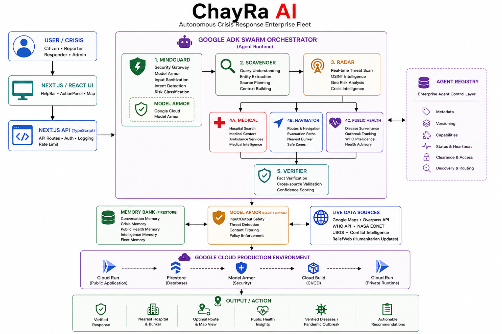

# ChayRa AI

### Autonomous Multi-Agent Crisis Response Platform

> **When the World Breaks, ChayRa Responds.**

[](https://nextjs.org/)
[](https://react.dev/)
[](https://www.typescriptlang.org/)
[](https://aws.amazon.com/bedrock/)
[](https://aws.amazon.com/dynamodb/)
[](https://docs.aws.amazon.com/sdk-for-javascript/v3/developer-guide/welcome.html)

ChayRa AI is an autonomous, multi-agent crisis-response application designed to help turn an emergency request into a coordinated operational response. It combines specialist agents, external intelligence sources, facility discovery, routing, evidence-oriented verification, and persistent operational memory in a single web interface.

Rather than treating a crisis as a one-question chatbot interaction, ChayRa coordinates a sequence of specialist tasks and returns structured results for the user to review.

---

## Live Application

**Production URL:**  
https://chayra.ranajitdhar.in


**Source Code:**  
https://github.com/ranajitdharpersonal/chayraai

---

## Why ChayRa?

A real-world emergency can require several decisions at once:

- What is happening, and how severe is it?
- Which response specialists should be involved?
- What relevant threat intelligence is available?
- Which mapped medical or shelter facilities may be nearby?
- What public-health alerts have trusted sources published?
- Which claims are supported by the available evidence?
- What useful session information should be retained?

ChayRa coordinates these activities through a multi-agent workflow and presents the results through a tactical web interface.

**One request. Multiple specialist agents. A coordinated response.**

---

## Core Capabilities

### Emergency request orchestration

Accepts a natural-language crisis request, validates the payload, creates a session, and executes the specialist workflow.

### Multi-agent crisis analysis

Routes work across specialist agents for context extraction, threat intelligence, medical first-aid guidance, facility discovery, public-health intelligence, rescue-beacon guidance, and evidence-oriented verification.

### Live and persisted threat intelligence

Collects global environmental and seismic event data from NASA EONET and USGS through a scheduled scan. The resulting snapshot is stored in DynamoDB and consumed by foreground crisis requests.

### Facility discovery and navigation

Uses OpenStreetMap Overpass data to look for mapped hospitals, clinics, shelters, and bunkers around supplied coordinates. Where possible, it requests road geometry from OSRM and falls back to a clearly identified straight-line estimate when routing is unavailable.

### Public-health intelligence

Retrieves relevant records from WHO Disease Outbreak News and UN ReliefWeb, distinguishes official-source records from model-generated analysis, and retains a last-known-good snapshot in DynamoDB.

### Evidence-oriented verification

The Verifier compares a user claim with the available stored radar intelligence. It is designed to avoid marking a claim as verified when the supplied evidence does not support it.

### Persistent operational memory

Stores session state, public-health snapshots, and radar snapshots in Amazon DynamoDB. Session records use an application-level 30-day expiry timestamp, with DynamoDB TTL available for eventual cleanup when configured on the table.

### Resilient response behavior

Uses agent-level fallbacks and previously stored snapshots where implemented, so an upstream model or data-source failure does not automatically erase all useful response context.

---

## Agent Fleet

| Agent | Responsibility |
|---|---|
| **MindGuard** | Basic structural input validation, including type, empty-input, length, and control-character checks. This is not a prompt-injection or content-security filter. |
| **Scavenger** | Extracts crisis context, estimates a threat level, and recommends optional specialist agents. |
| **Radar** | Reads the latest scheduled global threat snapshot stored in DynamoDB. |
| **Medical** | Produces concise emergency first-aid guidance, with local fallback protocols for selected scenarios. |
| **Navigator** | Discovers mapped hospitals and shelters/bunkers near user-provided coordinates and obtains road routes when available. |
| **PublicHealth** | Collects WHO and ReliefWeb records, generates a clearly separated analysis, and maintains a persistent snapshot. |
| **Vault** | Generates a rescue beacon and connectivity-related guidance, with a local fallback. |
| **Verifier** | Compares the user's claim with supplied radar intelligence and returns an evidence-oriented result. |

The agent metadata and handler registration are maintained in a custom `EnterpriseAgentRegistry`. The runtime adapts registered handlers into Google ADK agents and coordinates their execution.

---

## End-to-End Execution Flow

```text
User
  |
  v
Next.js web application
  |
  v
POST /api/swarm
  |
  v
Request validation + session initialization
  |
  v
Google ADK InMemoryRunner
  |
  v
MindGuard (basic input validation)
  |
  v
Scavenger (context + routing recommendations)
  |
  v
Radar (latest DynamoDB snapshot)
  |
  +-------------------------------+
  |               |               |
  v               v               v
Medical        Navigator       PublicHealth
  |               |               |
  +---------------+---------------+
                  |
             Optional Vault
                  |
                  v
              Verifier
                  |
                  v
     Persist session state to DynamoDB
                  |
                  v
       Structured API response
                  |
                  v
      Tactical UI, results and map
```

The runtime runs the initial validation and context stages, reads the saved radar snapshot, runs applicable specialist agents, and then attempts evidence-oriented verification. Medical is included in each crisis cycle; Navigator is included when valid user coordinates are present; Vault is conditional on Scavenger's recommendation. PublicHealth runs as part of the specialist stage.

---

## Architecture



### Application Layer

- **Next.js 16.3 / React 19** provides the web application and API routes.
- **TypeScript** is used across the application and server-side agent integrations.
- **Leaflet / React Leaflet** powers the interactive map experience.
- **Tailwind CSS**, **Framer Motion**, and **Lucide React** support styling, interaction, and UI assets.

### Agent Orchestration Layer

- **Google ADK (`@google/adk`)** provides the agent base classes, in-memory runner, session service, and event execution model currently used by the codebase.
- **EnterpriseAgentRegistry** stores each agent's handler and metadata, including version, role, status, and clearance level.
- **ChayRaCrisisFleet** coordinates the crisis stages and specialist execution.
- **Zod** is included in the application dependencies for schema validation where used.

### Model Inference Layer — Amazon Bedrock

All agent model inference is routed through a centralized gateway in `src/core/brain/brain.ts`.

- **Amazon Bedrock Runtime** is accessed through AWS SDK for JavaScript v3.
- The gateway uses the Bedrock `ConverseCommand` API.
- The model ID is configurable through `AWS_BEDROCK_MODEL_ID`.
- The current default model ID in code is `apac.amazon.nova-lite-v1:0`.
- The default AWS region in the central brain is `ap-south-1`.
- All agents call the shared `generateText()` function rather than creating separate model-provider integrations.
- No secondary or tertiary inference providers are enabled in the central brain configuration.

### Persistence Layer — Amazon DynamoDB

A shared DynamoDB document client is initialized lazily using the AWS SDK default credential provider chain.

The application uses a single-table configuration with:

- Partition key: `pk` (`String`)
- Sort key: `sk` (`String`)
- Table name: `CHAYRA_DATA_TABLE`

Current persisted records include:

| Record | Partition key (`pk`) | Sort key (`sk`) | Purpose |
|---|---|---|---|
| Session state | `SESSION#<sessionId>` | `STATE` | Crisis context, threat level, intelligence summary, event log, and expiry timestamp |
| Radar snapshot | `RADAR` | `GLOBAL_THREATS` | Latest scheduled NASA/USGS threat snapshot |
| Public-health snapshot | `PUBLIC_HEALTH` | `GLOBAL_HEALTH_WATCH` | Public-health advisory, official alerts, outbreak analysis, and metadata |

Session records receive an `expiresAt` Unix timestamp approximately 30 days after update. Configure DynamoDB TTL on `expiresAt` if automatic background expiry is desired; application reads also perform an expiry check.

---

## AWS Configuration

The current model and persistence integrations use AWS services.

| Variable | Purpose | Required |
|---|---|---|
| `AWS_REGION` | AWS region used by the Bedrock and DynamoDB clients | Recommended |
| `AWS_DEFAULT_REGION` | Fallback region for the DynamoDB client | Optional fallback |
| `AWS_ACCESS_KEY_ID` | Explicit AWS access key when not using an IAM role | Optional with IAM role |
| `AWS_SECRET_ACCESS_KEY` | Explicit AWS secret key paired with the access key | Optional with IAM role |
| `AWS_SESSION_TOKEN` | Session token for temporary credentials | Optional |
| `AWS_BEDROCK_MODEL_ID` | Amazon Bedrock model ID | Optional; defaults to `apac.amazon.nova-lite-v1:0` |
| `BRAIN_MAX_OUTPUT_TOKENS` | Central Brain maximum output token setting | Optional; defaults to `1536` and is bounded by code |
| `CHAYRA_DATA_TABLE` | DynamoDB table name | Required for persistence |
| `CRON_SECRET` | Bearer secret protecting the scheduled radar endpoint | Required for that endpoint |
| `RELIEFWEB_APPNAME` | ReliefWeb API application name | Required for ReliefWeb requests |
| `CHAYRA_ROUTING_URL` | OSRM-compatible routing base URL | Optional; defaults to the public OSRM demo endpoint |

The DynamoDB table must have string partition and sort keys named `pk` and `sk`. Enable TTL on `expiresAt` if you want DynamoDB to remove expired session items asynchronously.

Use an IAM role or another supported AWS credential-provider-chain mechanism in deployed environments wherever possible. Do not commit access keys, session tokens, cron secrets, or other credentials to the repository.

The application needs IAM permissions for the Bedrock model invocation operations used by the configured model and DynamoDB read/write operations on the configured table. Scope permissions to the required model and table resources where supported.

---

## API Routes

| Route | Method | Purpose |
|---|---|---|
| `/api/swarm` | `POST` | Validates the crisis request, runs the agent fleet, persists session state, and returns structured results. |
| `/api/background-radar` | `GET` | Read-only endpoint for the most recent DynamoDB radar snapshot. |
| `/api/cron/radar` | `GET` | Authenticated scheduled scan of NASA EONET and USGS followed by snapshot persistence. Requires `Authorization: Bearer <CRON_SECRET>`. |
| `/api/public-health` | `GET` | Returns a fresh DynamoDB public-health snapshot when available, otherwise refreshes from the PublicHealth agent and falls back to last-known-good state when possible. |

The scheduled radar route should be called by a trusted scheduler with the configured bearer secret. Do not expose `CRON_SECRET` in client-side code.

---

## External Intelligence and Mapping Sources

| Source | Use |
|---|---|
| **NASA EONET** | Global environmental events and event coordinates. |
| **USGS Earthquake Hazards Program** | Recent earthquake event feed. |
| **WHO Disease Outbreak News** | Official disease outbreak publications. |
| **UN ReliefWeb** | Humanitarian and public-health reports. |
| **OpenStreetMap Overpass API** | Mapped facilities such as hospitals, clinics, shelters, and bunkers. |
| **OSRM** | Road-route geometry and distance/duration when available. |

External availability, data coverage, mapping completeness, and update frequency depend on the respective providers. A mapped facility is not confirmation that it is open, staffed, accessible, or safe. A route or straight-line estimate is not a guarantee of travel conditions.

---

## Reliability and Failure Handling

ChayRa uses several forms of graceful degradation where implemented:

- If a model call fails, selected agents return local fallback guidance or a locally generated rescue-beacon identifier.
- If one specialist fails during the parallel stage, the runtime logs the failure and continues collecting other completed specialist results.
- If a radar scan source fails, the scan can preserve partial results from the other source; if both sources fail, the previous DynamoDB snapshot is not overwritten.
- If public-health refresh fails, the system can serve a previously stored verified snapshot when one is available.
- If OSRM routing is unavailable, Navigator can return a straight-line distance estimate and labels it as such.
- Persistence failures are logged and are designed not to discard an otherwise completed crisis response in the relevant memory-write paths.

These fallbacks improve resilience but do not guarantee uninterrupted operation. Always follow local emergency services and official safety instructions.

---

## Security Notes and Limitations

- MindGuard currently performs **basic structural input validation only**. It is not a prompt-injection detector, malware scanner, or content moderation service.
- The Verifier is evidence-oriented model assistance, not a formal fact-checking authority. Its output depends on the supplied radar snapshot and should be independently checked for consequential decisions.
- Medical output is general first-aid assistance, not diagnosis or a substitute for emergency medical care.
- OpenStreetMap facility records do not establish current facility status or safety.
- The frontend should not receive AWS credentials or server-only secrets.
- Protect scheduled endpoints, configure least-privilege IAM policies, and review logs for sensitive information before production use.

---

## Tech Stack

### Frontend

- Next.js 16.3
- React 19
- TypeScript 5
- Tailwind CSS 4
- Leaflet / React Leaflet
- Framer Motion
- Lucide React

### Agent Runtime

- Google ADK (`@google/adk`)
- Google GenAI SDK (`@google/genai`) for ADK content/session integration in the current route
- Custom `EnterpriseAgentRegistry`
- Custom `ChayRaCrisisFleet` orchestration runtime

### AI Inference

- Amazon Bedrock Runtime
- AWS SDK for JavaScript v3
- Bedrock Converse API
- Configurable Bedrock model ID (default: Amazon Nova Lite)

### AWS Persistence

- Amazon DynamoDB
- DynamoDB Document Client
- AWS SDK default credential provider chain

### External Data

- NASA EONET
- USGS Earthquake Hazards Program
- WHO Disease Outbreak News
- UN ReliefWeb
- OpenStreetMap Overpass
- OSRM

---

## Repository Structure

```text
chayraai/
├── public/                         # Static assets
├── src/
│   ├── app/
│   │   ├── api/
│   │   │   ├── background-radar/   # Read-only radar snapshot API
│   │   │   ├── cron/radar/          # Scheduled global scan endpoint
│   │   │   ├── public-health/       # Public-health snapshot API
│   │   │   └── swarm/               # Main crisis-response endpoint
│   │   ├── globals.css
│   │   ├── layout.tsx
│   │   └── page.tsx
│   ├── components/                  # Tactical UI, map, and action panels
│   └── core/
│       ├── adk/
│       │   ├── memory.ts            # DynamoDB-backed session and health memory
│       │   ├── registry.ts          # Agent metadata and handler registry
│       │   └── runtime.ts           # ADK-based crisis fleet orchestration
│       ├── agents/                  # Specialist agent handlers
│       ├── aws/
│       │   ├── dynamo.ts            # Shared DynamoDB client and table config
│       │   └── radar-snapshot.ts    # Radar snapshot persistence
│       └── brain/
│           └── brain.ts             # Central Amazon Bedrock inference gateway
├── ChayRa_AI_3_0_Architecture.png
├── Dockerfile
├── package.json
└── README.md
```

---

## Local Development

### Prerequisites

- Node.js compatible with the project's Next.js version
- npm
- AWS account access for Bedrock and DynamoDB-backed functionality
- A DynamoDB table configured with string keys `pk` and `sk`

### 1. Clone the repository

```bash
git clone https://github.com/ranajitdharpersonal/chayraai.git
cd chayraai
```

### 2. Install dependencies

```bash
npm install
```

### 3. Configure environment variables

Create a `.env.local` file in the project root and add the required configuration. Example:

```dotenv
AWS_REGION=ap-south-1
AWS_BEDROCK_MODEL_ID=apac.amazon.nova-lite-v1:0
CHAYRA_DATA_TABLE=your-dynamodb-table-name
RELIEFWEB_APPNAME=your-reliefweb-app-name
CRON_SECRET=replace-with-a-long-random-secret
```

Configure AWS credentials through the AWS SDK default credential provider chain or use an IAM role in your deployment environment. Add explicit credential variables only when appropriate for your environment. Never commit `.env.local`.

### 4. Start the development server

```bash
npm run dev
```

Open [http://localhost:3000](http://localhost:3000).

### 5. Build for production

```bash
npm run build
npm run start
```

### Available scripts

| Command | Description |
|---|---|
| `npm run dev` | Starts the Next.js development server. |
| `npm run build` | Creates a production build. |
| `npm run start` | Starts the production server. |
| `npm run lint` | Runs ESLint. |

---

## Deployment Considerations

The repository includes a `Dockerfile` and is structured as a Node.js/Next.js application. Deploy the application to a hosting environment that supports the required Node.js runtime, outbound HTTPS requests, environment variables, and AWS SDK credentials.

Before deploying:

1. Configure the runtime AWS region and an IAM role or secure credentials.
2. Grant the required Bedrock model invocation permissions.
3. Create the DynamoDB table with `pk` and `sk` string keys; enable TTL on `expiresAt` if desired.
4. Set `CHAYRA_DATA_TABLE`, `AWS_BEDROCK_MODEL_ID`, and other required server-side variables.
5. Configure a trusted scheduler to call `/api/cron/radar` with the `CRON_SECRET` bearer token.
6. Set `RELIEFWEB_APPNAME` if ReliefWeb integration is enabled.
7. Configure the public application URL and any production-specific routing endpoint.
8. Verify the production logs, API responses, agent execution, persistence, and external-source behavior.

The current code confirms AWS-backed Bedrock inference and DynamoDB persistence. The actual hosting provider and deployment environment should be determined from the deployment configuration used for the target environment, not inferred from the AWS data integrations alone.

---

## Contributing

Contributions, bug reports, and improvement suggestions are welcome. For substantial changes, open an issue first to discuss the proposed implementation. Please avoid committing secrets, generated build artifacts, or local environment files.

---

## License

This project is distributed under the license included in the [`LICENSE`](./LICENSE) file.

---

**Built by [Ranajit Dhar](https://github.com/ranajitdharpersonal).**
